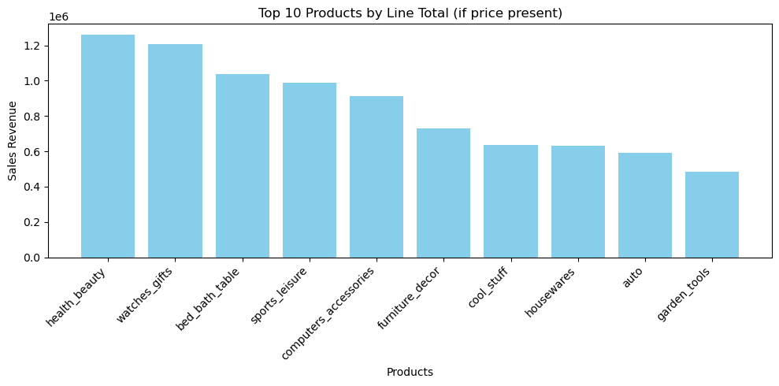
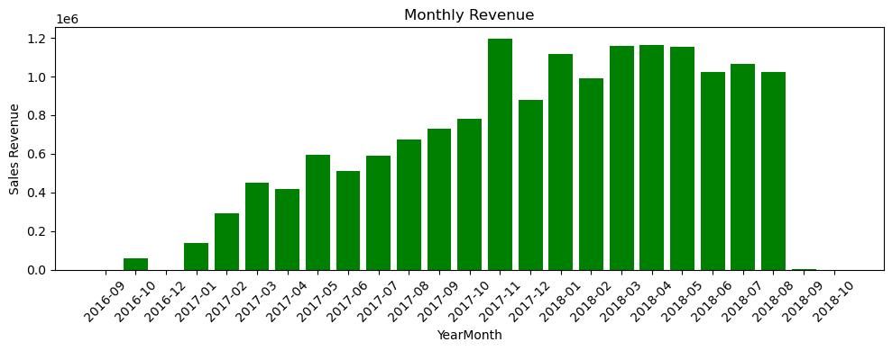
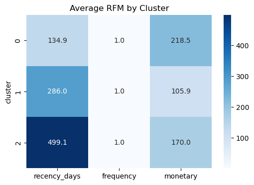

# End-to-End E-Commerce Analytics Pipeline

**Repository:** [github.com/nkongdem/End-to-End-E-Commerce-Analytics-Pipeline](https://github.com/nkongdem/End-to-End-E-Commerce-Analytics-Pipeline)

A complete data analytics pipeline on the Brazilian e-commerce dataset by Olist, turning raw relational transaction data into customer-level insights, RFM segments, and business visualizations.

## Overview

This project builds a complete data analytics pipeline using the Brazilian E-Commerce Public Dataset by Olist (Kaggle). The goal is to transform raw transactional data into structured business insights by cleaning, merging, aggregating, and analyzing customer and order data. The pipeline covers data preparation, feature engineering, RFM analysis, clustering, visualization, and exporting cleaned datasets for further business intelligence or machine learning applications.

## Objectives

- Load and integrate multiple relational CSV files
- Clean data (fix column names, parse dates, handle inconsistencies)
- Merge product category translations
- Build order-level and customer-level analytical datasets
- Compute RFM (Recency, Frequency, Monetary) metrics
- Assign R, F, M scores for customer segmentation
- Apply KMeans clustering to group customers
- Generate business-focused visualizations

## Dataset

**Brazilian E-Commerce Public Dataset by Olist** (Kaggle) — orders and order items, customers and sellers, products and product categories, payments and reviews, and geolocation data.

## Methodology

1. **Data Loading & Cleaning** — load multiple CSV files, standardize column names, parse date columns, handle missing values
2. **Data Integration** — merge product category translations, join orders/customers/payments/products into unified tables
3. **Feature Engineering** — build order-level and customer-level datasets, compute RFM metrics (recency, frequency, monetary), assign R/F/M scores by quantile
4. **Customer Segmentation** — apply KMeans clustering on RFM features, interpret cluster characteristics
5. **Visualization & Insights** — top-selling products, revenue by region, monthly sales trends, RFM score distributions, cluster heatmap
6. **Output & Export** — save cleaned/transformed datasets, produce summary insights for reporting

## Key findings

- Clear seasonal growth in monthly revenue through 2017–2018, with a sharp ramp-up from late 2016.
- A small set of products dominate revenue, making them priority candidates for inventory and marketing focus.
- RFM clustering separates customers into distinct behavioral groups, enabling targeted retention vs. re-engagement strategies.

## Contents

```
├── ecommerce-insights.ipynb      # Full pipeline: cleaning, RFM, clustering, visualization
├── ecommerce datasets/           # Raw Olist CSV source data
├── cleaned_simple/               # Exported cleaned datasets (orders, customer RFM)
├── charts/                       # Result chart images (shown above)
└── README.md
```

## Results

**Top-selling products by revenue**



**Monthly revenue trend**



**RFM heatmap by customer cluster**



## Tools

- Python, Pandas, NumPy
- Matplotlib, Seaborn — visualization
- Scikit-learn — KMeans clustering

## Future improvements

- Deploy an interactive dashboard (Power BI / Streamlit / Tableau)
- Implement advanced clustering techniques
- Build customer lifetime value (CLV) models
- Develop churn prediction models
- Automate the pipeline for real-time analytics
